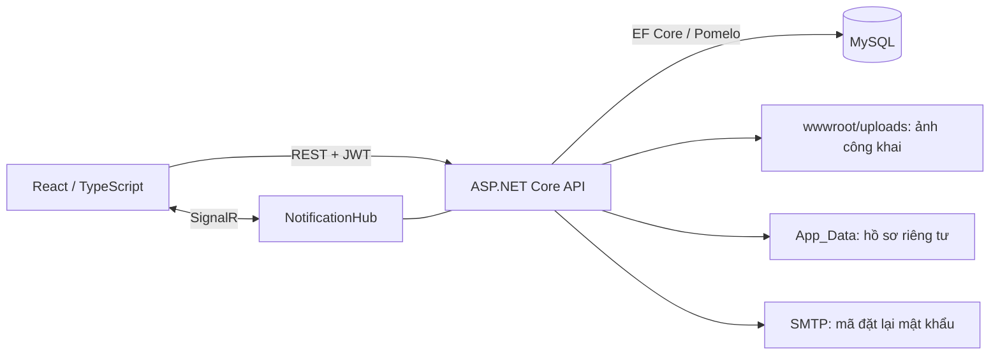

# Foodie — Đặt Món Ăn Online

Website đặt món ăn với ba khu vực: **Khách hàng**, **Nhà hàng** và **Quản trị viên**. Frontend React/TypeScript gọi ASP.NET Core Web API; dữ liệu lưu trong MySQL, thông báo cập nhật qua SignalR.

Đây là **đồ án demo**: MoMo, VNPay và ZaloPay là thanh toán mô phỏng; Foodie là ví ảo. Hoàn tiền hợp lệ được ghi vào ví Foodie. Đối soát ghi nhận thanh toán mô phỏng giữa hệ thống và quán, không chuyển tiền ngân hàng thật.

## Mục lục

- [Chức năng](#chức-năng)
- [Công nghệ và kiến trúc](#công-nghệ-và-kiến-trúc)
- [Cấu trúc repository](#cấu-trúc-repository)
- [Cài đặt và chạy local](#cài-đặt-và-chạy-local)
- [Cấu hình](#cấu-hình)
- [Database và dữ liệu demo](#database-và-dữ-liệu-demo)
- [Quy tắc nghiệp vụ](#quy-tắc-nghiệp-vụ)
- [API và realtime](#api-và-realtime)
- [Ảnh và hồ sơ pháp lý](#ảnh-và-hồ-sơ-pháp-lý)
- [Build và kiểm thử](#build-và-kiểm-thử)
- [Kịch bản demo](#kịch-bản-demo)
- [Xử lý lỗi thường gặp](#xử-lý-lỗi-thường-gặp)
- [Public GitHub và triển khai](#public-github-và-triển-khai)
- [Đóng góp](#đóng-góp)

## Chức năng

| Vai trò | Chức năng hiện có |
|---|---|
| Khách hàng (`KhachHang`) | Đăng ký/đăng nhập, đổi và đặt lại mật khẩu; hồ sơ, avatar, địa chỉ giao hàng; tìm nhà hàng, xem thực đơn/topping; giỏ riêng theo quán; lưu và áp dụng voucher; đặt hàng, thanh toán, hủy đơn hợp lệ; xem hoàn tiền, ví và lịch sử giao dịch; đánh giá đơn hoàn thành; thông báo. |
| Nhà hàng (`Quan`) | Hồ sơ và upload ảnh bìa; giờ mở cửa, chế độ tự động/thủ công/tạm ngừng; danh mục, món, nhóm topping và topping; khuyến mãi quán; xử lý đơn theo trạng thái; hồ sơ pháp lý và hợp đồng; ví/doanh thu; xác nhận hoặc tranh chấp đối soát; thông báo. |
| Quản trị (`Admin`) | Tổng quan, quản lý và khóa/mở tài khoản; duyệt hồ sơ nhà hàng; xem, thẩm định và chấm dứt hợp đồng theo quyền; khuyến mãi hệ thống; tra cứu đơn; báo cáo tài chính; tạo kỳ đối soát, giải quyết tranh chấp, ghi nhận thanh toán mô phỏng và xem lịch sử. |

Khách chưa đăng nhập có thể chuẩn bị giỏ ở trình duyệt; bước đặt hàng yêu cầu đăng nhập. Backend kiểm tra quyền sở hữu và điều kiện nghiệp vụ, không chỉ dựa vào việc ẩn nút trên giao diện.

**Giới hạn hiện tại:**

- Không có tài xế/GPS, cổng thanh toán thật, rút tiền hoặc chuyển khoản ngân hàng.
- API ví hiện có chức năng xem số dư/lịch sử và được sử dụng trong thanh toán, hoàn tiền, thu nhập đơn hàng. **Chưa có API nạp tiền demo**; các giá trị enum như `NapTien`, `RutTien`, `ChuyenTien` không đồng nghĩa tính năng đã được triển khai.
- Không có chữ ký số hoặc tích hợp nhà cung cấp hợp đồng điện tử.

## Công nghệ và kiến trúc

| Thành phần | Công nghệ |
|---|---|
| Backend | ASP.NET Core Web API, .NET 10 |
| Database | MySQL 8.0, Entity Framework Core 9, Pomelo MySQL 9 |
| Xác thực | JWT Bearer, role và kiểm tra tài khoản tại backend |
| Realtime | ASP.NET Core SignalR / `@microsoft/signalr` |
| Frontend | React 19, TypeScript 6, React Router 7, Vite 8 |
| Giao diện | CSS, Lucide React, Be Vietnam Pro |
| Xử lý file | SkiaSharp cho ảnh, PdfPig cho kiểm tra PDF |
| Tài liệu API | OpenAPI và Scalar trong Development |
| Kiểm thử | xUnit, EF InMemory, MySQL test riêng, Node test runner, Edge headless |

Phiên bản dependency chính xác nằm trong [API.csproj](DatMonAnOnline.API/DatMonAnOnline.API.csproj), [package.json](FE/package.json) và [package-lock.json](FE/package-lock.json).



Controller xử lý HTTP và phân quyền; service hỗ trợ giao dịch ví, thu nhập đơn, giữ giỏ, idempotency, email và realtime. Các background service xử lý đơn online quá hạn, hợp đồng hết hạn, phục hồi ghi nhận thu nhập và dọn bản ghi idempotency hết hạn.

## Cấu trúc repository

```text
DatMonAnOnline/
├── DatMonAnOnline.API/
│   ├── Common/                    # Validation, phân trang, tiền VND, giờ Việt Nam
│   ├── Controllers/               # REST API
│   ├── Database/
│   │   ├── Database.sql           # Schema + danh mục hệ thống cho cài mới
│   │   └── SeedDemo.sql           # Dữ liệu demo, chạy riêng trên DB sạch
│   ├── Hubs/                      # SignalR
│   ├── Models/                    # EF entities và DatMonAnOnlineContext
│   ├── Options/
│   ├── Security/
│   ├── Services/
│   ├── App_Data/                  # Local/private, không commit
│   ├── wwwroot/uploads/
│   │   ├── avatars/
│   │   ├── foods/
│   │   └── restaurants/
│   ├── Program.cs
│   └── appsettings.json           # Giá trị mặc định; secret được cấp ngoài Git
├── DatMonAnOnline.Tests/           # Unit/integration tests backend
├── FE/
│   ├── public/images/             # Ảnh dự phòng
│   ├── src/components/
│   ├── src/hooks/
│   ├── src/pages/
│   ├── src/services/
│   ├── src/utils/
│   ├── src/App.tsx                # Routes và role guards
│   ├── src/App.css
│   ├── tests/
│   └── .env.example
├── scripts/
│   ├── demo-images/               # Manifest, công cụ và kiểm thử ảnh demo
│   ├── sanitize-demo-seed.mjs
│   ├── sanitize-demo-seed.test.mjs
│   ├── test-fe-routes.mjs
│   └── test-isolated-mysql.ps1
├── DatMonAnOnline.slnx
├── .gitignore
└── README.md
```

`bin/`, `obj/`, `FE/dist/`, `node_modules/`, `.build-check/` và private uploads không thuộc source cần commit. Không xóa cả `.build-check/` như cache thông thường: workspace local có thể dùng nó để lưu backup và MySQL test datadir.

## Cài đặt và chạy local

### 1. Chuẩn bị môi trường

- .NET SDK **10**.
- **MySQL 8.0.16 trở lên** để CHECK được thực thi; các kiểm thử MySQL của dự án dùng 8.0.45.
- Node.js đáp ứng Vite: `^20.19.0 || >=22.12.0`. Nên dùng **Node.js 24** để chạy cả các test Node đang import TypeScript trực tiếp.
- npm, Git và MySQL CLI hoặc MySQL Workbench.
- Edge headless chỉ cần cho browser tests; Pillow chỉ cần nếu tạo/chuyển đổi lại ảnh nguồn.

Không mặc định dịch vụ database đi kèm XAMPP là MySQL 8.0; hãy kiểm tra phiên bản thực tế. MariaDB chưa được xác minh tương thích với bộ SQL này.

```powershell
dotnet --version
node --version
npm --version
mysql --version
```

Clone repository bằng URL do nhóm cung cấp, rồi mở terminal tại thư mục gốc `DatMonAnOnline`.

### 2. Khởi tạo database mới

**Chỉ dùng hai lệnh dưới cho môi trường mới, chưa có database `DatMonAnOnline`.** Tắt API khi import. Script dùng tên database cố định; đây không phải lệnh nâng cấp hoặc cập nhật database đang sử dụng.

Chạy lần lượt từ thư mục gốc; chỉ chạy lệnh thứ hai nếu lệnh thứ nhất thành công:

```powershell
mysql --default-character-set=utf8mb4 -u root -p --execute="source DatMonAnOnline.API/Database/Database.sql"
mysql --default-character-set=utf8mb4 -u root -p --execute="source DatMonAnOnline.API/Database/SeedDemo.sql"
```

- `Database.sql` dùng `CREATE DATABASE`, không có `DROP DATABASE`; database đã tồn tại sẽ báo lỗi.
- `SeedDemo.sql` có `START TRANSACTION`/`COMMIT`, sử dụng ID và mã cố định. Nó **không phải script upsert/idempotent**; chạy lại sẽ gặp lỗi khóa trùng.
- Không dùng `--force`, không tiếp tục chạy các câu còn lại khi import lỗi. Nếu chạy trong phiên Workbench còn mở, rollback transaction đang dang dở trước khi xử lý.
- Seed hiện tại có sẵn **16 tài khoản demo tổng hợp**. Đây là dữ liệu của file seed hiện hành, không phải bước tạo tài khoản production.
- Nếu chỉ cần schema để tự nhập dữ liệu, bỏ qua lệnh seed.

### 3. Cấu hình backend bằng User Secrets

Chạy từ thư mục gốc; thay các placeholder bằng cấu hình riêng của máy:

```powershell
dotnet user-secrets set "ConnectionStrings:DefaultConnection" "Server=localhost;Port=3306;Database=DatMonAnOnline;Uid=<db-user>;Pwd=<db-password>;" --project DatMonAnOnline.API
dotnet user-secrets set "Jwt:Secret" "<chuoi-ngau-nhien-it-nhat-32-byte>" --project DatMonAnOnline.API
```

UserSecretsId đã có trong project; không cần chạy `user-secrets init`. Tài khoản MySQL chạy API nên có quyền đọc/ghi dữ liệu cần thiết; dùng tài khoản có quyền DDL riêng cho bước cài schema. Không commit connection string, JWT secret hoặc mật khẩu SMTP.

### 4. Chạy API

```powershell
dotnet restore DatMonAnOnline.API/DatMonAnOnline.API.csproj
dotnet run --project DatMonAnOnline.API/DatMonAnOnline.API.csproj --launch-profile http
```

| Thành phần | Địa chỉ local |
|---|---|
| API | `http://localhost:5038/api` |
| OpenAPI JSON | `http://localhost:5038/openapi/v1.json` |
| Scalar | `http://localhost:5038/scalar/v1` |
| SignalR | `http://localhost:5038/hubs/thong-bao` |

Profile `http` đặt môi trường Development. Profile `https` dùng `https://localhost:7198` và HTTP 5038; nếu chọn HTTPS, cần chứng chỉ development được tin cậy và cấu hình FE tương ứng.

### 5. Chạy frontend

Mở terminal thứ hai:

```powershell
cd FE
npm ci
npm run dev
```

Mở `http://localhost:5173`. Development mặc định gọi API tại `http://localhost:5038/api`.

Nếu API ở URL khác, tạo `FE/.env.local` theo [mẫu](FE/.env.example):

```dotenv
VITE_API_URL=http://localhost:5038/api
```

Khởi động lại Vite sau khi đổi env. Biến `VITE_*` được đưa vào bundle trình duyệt, **không dùng để lưu secret**.

### 6. Chuẩn bị hồ sơ và đăng nhập demo

Ảnh món/quán có sẵn trong repository, nhưng **30 tệp hồ sơ/hợp đồng trong `App_Data` của workspace local không được Git tracking**. Clone source và import SQL không tự tạo các PDF này.

Để demo việc xem/thẩm định hồ sơ trên máy mới, cần bộ tài liệu mẫu không nhạy cảm do nhóm bàn giao riêng, đúng đường dẫn ghi trong seed; hoặc thực hiện luồng upload, ký mô phỏng và duyệt qua ứng dụng. Không thay bằng giấy tờ thật trong repository hoặc bỏ validation.

Dùng thông tin đăng nhập demo do nhóm cung cấp. Không sử dụng mật khẩu demo cho tài khoản thật. Bộ seed có ngày hợp đồng/voucher cố định: khi demo ở thời điểm khác, phải kiểm tra hiệu lực và xử lý theo workflow hiện có; không chỉnh đồng hồ máy để vượt điều kiện.

## Cấu hình

| Khóa | Mục đích |
|---|---|
| `ConnectionStrings:DefaultConnection` | Kết nối MySQL; bắt buộc |
| `Jwt:Secret` | Khóa ký tối thiểu 32 byte; bắt buộc cấp ngoài source |
| `Jwt:Issuer`, `Jwt:Audience` | Mặc định `Foodie.Api`, `Foodie.Web` |
| `DoiSoat:BatDauApDung` | Mốc đơn hàng áp dụng snapshot tài chính; không tự dịch mốc để đưa đơn cũ vào đối soát |
| `Cors:AllowedOrigins` | Danh sách origin chính xác; Development mặc định localhost 5173 và 5174 |
| `ReverseProxy:KnownProxies` | IP proxy được tin cậy khi xử lý forwarded headers |
| `AllowedHosts` | Host được phép; cấu hình cụ thể khi public |
| `Email:Smtp:Host`, `Port`, `EnableSsl` | Kết nối SMTP |
| `Email:Smtp:UserName`, `Password` | Xác thực SMTP nếu dịch vụ yêu cầu |
| `Email:Smtp:FromAddress`, `FromName` | Thông tin người gửi |
| `VITE_API_URL` | API base của FE, có hậu tố `/api` |

Có thể dùng biến môi trường với dấu `__`, ví dụ `ConnectionStrings__DefaultConnection`, `Jwt__Secret`, `Cors__AllowedOrigins__0`.

**Quên mật khẩu:** source hiện không trả OTP thử nghiệm ra response, kể cả Development. Cần SMTP hoạt động để nhận mã; có thể dùng SMTP local phục vụ kiểm thử. Môi trường ngoài Development kiểm tra cấu hình SMTP khi khởi động. Không ghi OTP hoặc token vào log.

Token hiện được cấp với thời hạn một ngày. Backend còn kiểm tra trạng thái tài khoản, role và phiên bản mật khẩu; khóa tài khoản/đổi mật khẩu có thể làm phiên cũ mất hiệu lực trước hạn.

## Database và dữ liệu demo

Schema do [Database.sql](DatMonAnOnline.API/Database/Database.sql) định nghĩa; EF mapping ở [DatMonAnOnlineContext.cs](DatMonAnOnline.API/Models/DatMonAnOnlineContext.cs). Repository hiện không có bộ EF Migrations để chạy `dotnet ef database update`.

Thư mục `Database/` chỉ có `Database.sql` và `SeedDemo.sql`. Những thay đổi về giới hạn voucher, lịch sử đối soát và loại giao dịch thu nhập đơn được tích hợp trong schema cài mới. **Không có bộ script nâng cấp hoàn chỉnh cho database cũ trong thư mục hiện tại**; phải đối chiếu và chuẩn bị migration tăng dần riêng trước khi nâng cấp, không import installer lên dữ liệu đang dùng.

Các số liệu sau được đếm từ **nội dung seed**, không phải kết quả chạy lại seed trên database thật trong lần cập nhật README:

| Dữ liệu | Số lượng |
|---|---:|
| Tài khoản demo | 16: 1 Admin, 10 Quán, 5 Khách hàng |
| Nhà hàng / hồ sơ pháp lý / hợp đồng | 10 mỗi loại |
| Danh mục món | 32 |
| Món ăn | 124 |
| Nhóm topping / topping | 45 / 155 |
| Đơn hoàn thành | 30 |
| Đơn bổ sung ở trạng thái chờ, xác nhận, chuẩn bị, giao, hủy | 5 |
| Đánh giá món / nhà hàng | 20 / 20 |
| Kỳ đối soát | 10 |
| Ảnh WebP | 134: 10 bìa + 124 món |

Seed còn có địa chỉ, voucher, lịch sử trạng thái, thanh toán, ví/ledger, thông báo và chi tiết đối soát. Không coi seed là bản sao production hoặc bằng chứng tất cả tình huống nghiệp vụ đã được kiểm thử.

## Quy tắc nghiệp vụ

### Giỏ, checkout và đơn hàng

- Giỏ tách theo khách và nhà hàng; topping phải thuộc nhóm được phép của món.
- Backend tính lại giá, phí giao hàng, voucher và tổng thanh toán tại checkout.
- Sau khi lấy khóa, checkout kiểm tra lại nhà hàng đang nhận đơn, tài khoản chủ quán, duyệt và hợp đồng hiệu lực.
- Thời hạn giữ giỏ checkout được lưu ở `giohang.GiuCheckoutDenUtc`; không phải trạng thái chỉ nằm trong RAM.
- Đơn lưu snapshot tên món, topping, giá và các khoản phí/giảm giá.
- Trạng thái xử lý: `ChoXacNhan → DaXacNhan → DangChuanBi → DangGiao → HoanThanh`.
- API hủy thông thường chỉ nhận đơn ở bước chờ/đã xác nhận theo quyền. Đơn online chưa trả tiền được background service kiểm tra để tự hủy sau 15 phút.
- Các luồng ghi tiền/đơn dùng transaction, row lock và kiểm tra trạng thái; request hỗ trợ idempotency dùng header `Idempotency-Key`. Khi retry cùng yêu cầu, FE tái sử dụng key.

### Thanh toán, ví và khuyến mãi

- `COD`: ghi nhận thu tiền khi hoàn thành đơn; không hoàn ví cho khoản COD chưa thu.
- `FoodPay` là tên phương thức trong DB/API của ví Foodie.
- `Momo`, `VNPay`, `ZaloPay`: xác nhận kết quả mô phỏng, không kết nối cổng thật.
- Hủy hợp lệ đơn online đã trả tiền sẽ hoàn về Foodie. Ví và ledger phải được cập nhật cùng transaction; không sửa số dư trực tiếp.
- Giới hạn voucher toàn hệ thống và mỗi khách được kiểm tra tại backend. Khi hủy hợp lệ, chỉ trả lượt còn trong khoảng hiệu lực theo quy tắc hiện tại.
- VND dùng số nguyên và `MidpointRounding.AwayFromZero`: 0,5 làm tròn ra xa 0; với số tiền dương là làm tròn lên. Không tính lại snapshot lịch sử chỉ vì công thức hoặc cấu hình mới.

### Hợp đồng, đánh giá và đối soát

- Nhà hàng phải được duyệt và có hợp đồng `HieuLuc` trong khoảng ngày hợp lệ để nhận đơn mới. Đơn đã tạo hợp lệ tiếp tục theo quy trình xử lý.
- Chỉ khách sở hữu đơn `HoanThanh` được đánh giá món thuộc đơn đó; kiểm tra số sao, nội dung và chống trùng theo đơn.
- Chỉ tạo đối soát đến hết ngày đã kết thúc theo giờ Việt Nam (`Asia/Ho_Chi_Minh`).
- Không tạo kỳ chồng lấn cho cùng quán; một đơn không được thuộc hai kỳ.
- Công thức tổng kỳ: **số tiền cần đối soát = tổng nhà hàng được hưởng − tổng nhà hàng đã nhận/thu**, gồm COD và khoản đã ghi vào ví theo logic hiện hành.
- Số dương: hệ thống còn phải trả quán. Số âm: quán còn phải trả hệ thống. Số 0: không phát sinh công nợ.
- Kỳ tranh chấp phải được giải quyết trước thanh toán; lịch sử lưu người thao tác, trạng thái, thời gian, mã giao dịch và ghi chú.
- `DaThanhToan` chỉ là ghi nhận hoàn tất **mô phỏng**; không có chuyển khoản ngân hàng.

## API và realtime

Routes chi tiết và DTO xem tại Scalar khi chạy Development. Những nhóm chính:

| Nhóm | Route |
|---|---|
| Xác thực | `/api/auth` |
| Nhà hàng / món / danh mục | `/api/nha-hang`, `/api/mon-an`, `/api/danh-muc` |
| Topping | `/api/nhom-topping`, `/api/topping` |
| Giỏ / địa chỉ | `/api/gio-hang`, `/api/dia-chi` |
| Đơn / thanh toán / ví | `/api/don-hang`, `/api/thanh-toan`, `/api/vi` |
| Khuyến mãi | `/api/khuyen-mai` |
| Đánh giá | `/api/danh-gia-mon-an`, `/api/danh-gia-nha-hang`; đọc qua món/quán |
| Hồ sơ / hợp đồng quán | `/api/nha-hang/ho-so-phap-ly`, `/api/nha-hang/hop-dong` |
| Đối soát | `/api/admin/doi-soat`, `/api/nha-hang/doi-soat` |
| Quản trị | `/api/admin` |
| Thông báo / hub | `/api/thong-bao`, `/hubs/thong-bao` |

Request được bảo vệ dùng `Authorization: Bearer <token>`. Quyền còn phụ thuộc vai trò và chủ sở hữu bản ghi; route guard FE không thay thế authorization backend.

Thông báo được lưu DB; SignalR giúp giao diện cập nhật realtime, không bảo đảm phát lại mọi sự kiện bị lỡ. Sau reconnect, FE tải lại dữ liệu liên quan qua API. Hệ thống hiện chưa cấu hình SignalR backplane cho nhiều API instance.

## Ảnh và hồ sơ pháp lý

- 10 bìa và 124 ảnh món AI nằm trong `wwwroot/uploads/restaurants/` và `wwwroot/uploads/foods/`, dùng tiền tố `demo-v1-`.
- Ảnh WebP được chuẩn bị sẵn, tổng khoảng **9,80 MiB**; không cần mạng ngoài để tải bộ ảnh khi demo local.
- Bìa: 1280×720; món: 800×600. Nguồn, prompt và checksum nằm trong [manifest](scripts/demo-images/manifest.json).
- FE giải quyết URL qua API base và hiển thị SVG dự phòng khi ảnh lỗi.
- Nhà hàng chọn file để upload ảnh bìa, xem trước rồi lưu hồ sơ. Backend kiểm tra ảnh và tạo file mới, không ghi đè ảnh demo hoặc tự xóa ảnh người dùng.
- `App_Data/HopDong/` và `App_Data/HoSoPhapLy/` là dữ liệu riêng tư, phục vụ qua API kiểm tra quyền; không chuyển vào `wwwroot`.

Xem [hướng dẫn ảnh demo](scripts/demo-images/README.md) để kiểm tra ảnh, chuyển đổi ảnh nguồn hoặc dùng công cụ gắn ảnh vào database local. Không chạy công cụ với `--apply` nếu chưa chủ động chọn database demo cần cập nhật.

## Build và kiểm thử

Chạy từ thư mục gốc, trừ nhóm lệnh FE:

```powershell
dotnet build DatMonAnOnline.API/DatMonAnOnline.API.csproj -c Release

cd FE
npm ci
npm run lint
npm run build
cd ..

node --test FE/tests/api-url.test.mjs FE/tests/settlement-date.test.mjs scripts/sanitize-demo-seed.test.mjs
node scripts/demo-images/verify.mjs
node scripts/test-fe-routes.mjs
```

Browser test cần FE đã build và Edge; có thể chỉ định đường dẫn trình duyệt qua `FOODIE_TEST_BROWSER`. Nó dùng API giả lập, không phải kiểm thử E2E với database đang chạy.

Kiểm thử upload/ảnh bằng Kestrel và EF InMemory:

```powershell
dotnet test scripts/demo-images/Verification/Verification.csproj -c Release
node scripts/demo-images/browser-test.mjs
```

Bộ test backend chính:

```powershell
dotnet test DatMonAnOnline.slnx -c Release
```

**Tồn đọng đã xác nhận:** [project test](DatMonAnOnline.Tests/DatMonAnOnline.Tests.csproj) còn tham chiếu `Database/20261023_AddPromotionPerCustomerLimit.sql`, nhưng file này không còn trong cây hiện tại. Lệnh build solution/test sẽ gặp **MSB3030** trước khi chạy tests. API project riêng vẫn build được. Cần xử lý tài nguyên migration/test tương thích trong task riêng; không xóa test để che lỗi.

Sau khi giải quyết blocker, có thể chạy integration tests bằng:

```powershell
powershell -NoProfile -File scripts/test-isolated-mysql.ps1 -Filter ""
```

Script này hiện dành cho Windows với MySQL 8.0 ở đường dẫn cài đặt ghi trong script. Nó dùng cổng loopback **13487**, datadir riêng trong `.build-check/` và database test tách biệt. Không đổi cấu hình test sang database đang dùng. Không bật `FOODIE_RUN_MYSQL_TESTS=1` nếu chưa chuẩn bị đúng instance cách ly; tests không bật cờ sẽ bị skip.

Kết quả kiểm tra gần nhất sau đợt cleanup:

| Kiểm tra | Kết quả |
|---|---|
| Build API Release | PASS |
| Build FE / ESLint | PASS |
| Node unit tests | 10/10 PASS |
| Browser smoke test routing | 6/6 PASS; chạy ngoài sandbox khi trình duyệt không khởi động trong sandbox |
| Manifest, file ảnh và đường dẫn seed | 134/134 PASS, đúng 2 SQL |
| Full .NET tests | Chưa chạy được do MSB3030 nêu trên |
| Import lại schema/seed trên MySQL sạch | Chưa chạy lại trong đợt cleanup/cập nhật README |

Build PASS không đồng nghĩa toàn bộ nghiệp vụ đã PASS. Các lệnh trên là hướng dẫn kiểm tra, không phải chứng nhận tất cả test đã chạy thành công.

## Kịch bản demo

1. Khách xem danh sách quán, thực đơn, ảnh món và topping.
2. Đăng nhập khách, chọn địa chỉ và lưu voucher còn hiệu lực.
3. Đặt đơn COD; chuyển sang tài khoản quán để xác nhận, chuẩn bị, giao và hoàn thành.
4. Khách đánh giá đơn đã hoàn thành, kiểm tra thông báo.
5. Thử một đơn thanh toán mô phỏng; hủy ở trạng thái được phép rồi kiểm tra khoản hoàn Foodie.
6. Với tài khoản đủ số dư, đặt bằng ví và kiểm tra lịch sử cộng/trừ.
7. Admin xem tài chính, hợp đồng và đối soát; dùng dữ liệu hoàn thành của **ngày đã kết thúc**, chưa thuộc kỳ khác.
8. Quán xác nhận hoặc tranh chấp kỳ; Admin giải quyết và ghi nhận thanh toán mô phỏng.

Trước khi demo, kiểm tra hợp đồng còn hiệu lực, quán đang mở và voucher phù hợp. Các đơn seed đã nằm trong kỳ đối soát sẽ không được chọn lại khi tạo kỳ mới.

## Xử lý lỗi thường gặp

| Hiện tượng | Kiểm tra |
|---|---|
| API không khởi động vì thiếu cấu hình | Cấp connection string và JWT secret qua User Secrets/env; MySQL phải chạy vì API AutoDetect phiên bản lúc khởi động. |
| Database đã tồn tại khi import | Dừng import. Không chạy tiếp seed lên DB đang dùng; chọn môi trường MySQL demo riêng hoặc chuẩn bị nâng cấp có kiểm soát. |
| Seed báo trùng khóa | Seed dành cho DB sạch và dùng ID cố định; không dùng `--force` hoặc xóa dữ liệu để né lỗi. |
| 500, thiếu bảng/cột voucher hoặc đối soát | Kiểm tra schema thực tế và DB mà API kết nối. Không import lại installer lên DB có dữ liệu. |
| Không hiện nhà hàng/không đặt được | Kiểm tra duyệt, tài khoản chủ quán, hợp đồng, giờ mở cửa, chế độ hoạt động và trạng thái bán món/topping. |
| 401/403 | Kiểm tra phiên đăng nhập, role, tài khoản bị khóa/đổi mật khẩu và chủ sở hữu dữ liệu; đăng nhập lại khi phiên mất hiệu lực. |
| Không nhận mã đặt lại mật khẩu | Kiểm tra SMTP; API hiện không trả mã thử nghiệm trong response. |
| CORS hoặc Failed to fetch | Đồng bộ `VITE_API_URL`, URL API đang chạy và `Cors:AllowedOrigins`; origin không chứa path hoặc dấu `/` cuối. |
| Ảnh 404 | Kiểm tra file trong `wwwroot/uploads`, path seed/DB và cấu hình API base; chạy `node scripts/demo-images/verify.mjs`. |
| File pháp lý không tìm thấy sau clone | SQL chỉ lưu đường dẫn; cần bộ PDF demo riêng hoặc thực hiện luồng hồ sơ qua ứng dụng. |
| Không tạo được đối soát | Chỉ chọn ngày đã kết thúc theo giờ Việt Nam; kiểm tra mốc áp dụng, kỳ trùng và đơn đã đối soát. |
| Test .NET lỗi MSB3030 | Xem blocker migration ở phần Build và kiểm thử; đây không phải lỗi kết nối MySQL. |
| `npm run preview` không gọi được API | Bản production mặc định dùng `/api`; preview không tự proxy backend. Cần API base lúc build và CORS tương ứng hoặc reverse proxy cùng origin. |

## Public GitHub và triển khai

### Public source

- Review `git status`, staged diff và file untracked; không dùng số lượng file thay đổi làm tiêu chí commit an toàn.
- Không commit secret, file `.env.local`, private uploads, `App_Data`, database backup hoặc cache IDE.
- Ảnh demo và manifest được phép nằm trong source; ảnh upload cá nhân được ignore.
- Các lần kiểm tra trước đã ghi nhận credential và giấy tờ trong lịch sử Git cũ. **Working tree sạch/.gitignore không loại bỏ nội dung đã commit.** Chủ sở hữu cần xác minh thu hồi credential, chọn phương án xuất bản source/lịch sử phù hợp và kiểm tra lại trước public.
- Tài khoản/credential demo không được tái sử dụng ở môi trường chứa dữ liệu thật.
- Repository hiện chưa có file LICENSE; không tự suy diễn giấy phép cho toàn bộ source. Thông tin nguồn ảnh demo nằm trong manifest.

### Triển khai website demo

Build backend và frontend:

```powershell
dotnet publish DatMonAnOnline.API/DatMonAnOnline.API.csproj -c Release -o .build-check/publish-api

cd FE
npm ci
npm run build
cd ..
```

- Cấp `ASPNETCORE_ENVIRONMENT=Production`, connection string, JWT secret, SMTP, `AllowedHosts` và danh sách proxy tin cậy qua môi trường triển khai.
- Dùng HTTPS; API đã có HTTPS redirection và HSTS ngoài Development. Cấu hình forwarded headers đúng IP reverse proxy.
- Nếu cùng domain: phục vụ `FE/dist`, proxy `/api`, `/hubs` và `/uploads` tới API; bật WebSocket và SPA fallback cho routes FE.
- Nếu API khác domain: đặt `VITE_API_URL=https://api.example.invalid/api` **trước khi build** và khai báo origin HTTPS chính xác ở backend.
- Lưu bền vững MySQL, public uploads và private `App_Data`; kiểm tra quyền ghi và quy trình backup/restore.
- Mặc định các endpoint thanh toán vẫn là mô phỏng. Public website phải thể hiện rõ phạm vi demo và không sử dụng tiền/dữ liệu thật.
- Khi mở rộng nhiều instance, cần đánh giá SignalR backplane, hàng đợi email và các trạng thái theo process; chưa có cấu hình triển khai phân tán hoàn chỉnh.
- Theo dõi log, lỗi background job và các giao dịch cần phục hồi; không ghi token/OTP/secret vào log.

Không coi bản hiện tại đã sẵn sàng public production: còn blocker test, việc chuẩn bị hồ sơ demo trên máy mới và việc xử lý lịch sử nhạy cảm cần hoàn tất.

## Đóng góp

1. Tạo branch cho thay đổi; giữ nguyên API contract và nghiệp vụ ngoài phạm vi task.
2. Với đơn/tiền/voucher/đối soát, kiểm tra transaction, concurrency, retry/idempotency và quyền sở hữu.
3. Thay đổi database hiện có cần migration tăng dần đã kiểm thử; không dùng installer hoặc seed để nâng cấp.
4. Chạy build, lint và tests liên quan; báo rõ FAIL/SKIP/NOT TESTED.
5. Review diff, tài nguyên ảnh và dữ liệu nhạy cảm trước commit.
6. Cập nhật README khi đổi cách cài đặt, cấu hình hoặc giới hạn của dự án.
